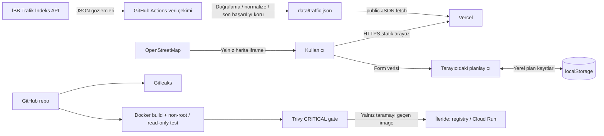

# Kuryeplan mimarisi ve veri akışı

## Bileşenler

- **Kullanıcı tarayıcısı:** Statik HTML/CSS/JavaScript arayüzünü indirir; teslim zamanı geriye doğru planlama hesabı tarayıcıda çalışır. Plan kayıtları `localStorage` içindedir.
- **İBB trafik indeksi servisi:** Tarihsel (`28/H`) ve kısa aralıklı (`1/5M`) JSON uç noktaları İstanbul şehir geneli indeks sağlar; ilçe/rota seviyesinde ayrıştırmaz.
- **GitHub Actions veri hattı:** Günlük olarak Python betiğini çalıştırır, kaynak yanıtını doğrular ve `data/traffic.json` dosyasını ayrı `traffic-data` dalına commit eder. Arayüz güncel JSON dosyasını `raw.githubusercontent.com` üzerinden alır; günlük veri yenilemesi Vercel rebuild gerektirmez ve `main` dalı koruma altında kalabilir. History zorunludur; geçersiz history sonucu önceki dosyayı bozmaz. Güncel endpoint başarısızsa işaretli saatlik fallback kullanılabilir.
- **Vercel static hosting:** `index.html`, dashboard JS, CSS, `data/traffic.json` ve `/.well-known/security.txt` dosyalarını HTTPS üzerinden sunar.
- **GitHub Actions güvenlik gate:** Gitleaks, Docker build, UID/GID doğrulaması, salt okunur smoke test ve Trivy CRITICAL taraması. Kritik bulgu release adımını başarısız yapar.
- **NGINX unprivileged container:** Aynı statik dosyaları 8080 portundan `101:101` ile sunacak şekilde tasarlanmıştır.
- **Cloud Run/Azure Container Apps:** Ödev kartının hedefidir ama kullanıcı hesabı doğrulama/ödeme engeli nedeniyle şimdilik ertelenmiştir. Canlı bulut bileşeni varmış gibi raporlanmamalıdır.
- **OpenStreetMap:** Sadece bölgesel harita çerçevesi. Harita hizmetine erişim anında tarayıcı OSM'ye bağlanır.

## Veri akışı (DFD)

## Güven sınırları

1. **Tarayıcı:** Form girdileri ve yerel plan kayıtları kullanıcı cihazında tutulur. Mevcut sürümde siparişleri saklayan backend yoktur.
2. **Veri sağlayıcı ↔ GitHub Actions:** API anahtarı kullanılmayan uç noktalardan veri çekimi; giriş boyutu 8 MB ile sınırlıdır, sayısal indeks 0–100 aralığında doğrulanır. Tarihsel endpoint başarısızsa son başarılı JSON atomik olarak korunur.
3. **Depo/CI:** Gerçek token, parola veya service-account key depoya konmaz. Workflow permissions en az yetkiyle tanımlanır.
4. **Web yayını:** Vercel başlıkları CSP, HSTS, nosniff, Referrer-Policy, Permissions-Policy ve frame koruması sağlar. Gerçek derece/score yalnızca online scan sonrası raporlanır.
5. **Container:** Production image non-root (`101:101`) ve read-only filesystem testi için yapılandırılır. Trivy critical gate geçmeden deploy adımı koşmamalıdır.
6. **Harita dış hizmeti:** OSM yalnız harita görüntüsünü getirir; plan formu veya yerel planlar bu URL'ye parametre olarak gönderilmez.

## Veri sınıflandırması ve sınırlılıklar

İBB indeks verisi İstanbul şehir geneli göstergedir. Çıkış/varış ilçesi seçimi operatöre plan bağlamı verir; kaynak ilçe çifti için ölçüm sağlamadığı için öneri gerçek rota süresi veya en hızlı güzergâh anlamına gelmez. Harita GPS tabanlı kurye konumu göstermez. Gerçek saha operasyonu, teslimat garantisi, sipariş entegrasyonu veya müşteri veritabanı yoktur.

Kaynağın tam lisans/atıf şartı teslim öncesi portaldan doğrulanmalıdır. Kaynak verisi ilk kez başarıyla çekilene kadar panel boş durum göstermeli; sahte indeks üretmemelidir.
