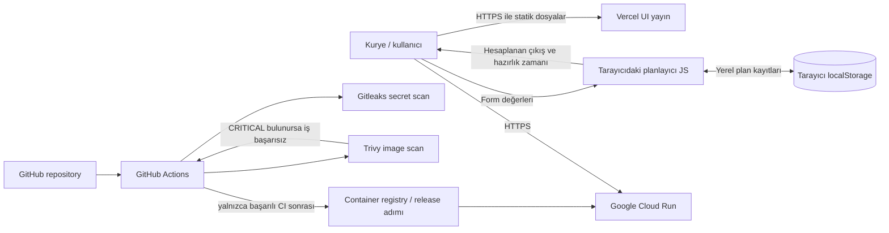

# Mimari ve veri akışı

## Bileşenler

- **Kullanıcı tarayıcısı:** Statik HTML/CSS/JavaScript'i indirir, hesaplamayı istemci tarafında yapar.
- **Vercel static hosting (UI yayını):** Statik dosyaları HTTPS ile sunar ve güvenlik başlıklarını uygular.
- **NGINX unprivileged container (kursun Docker ürünü):** Aynı statik dosyaları 8080 portundan sunar; süreç UID/GID `101:101` ile çalışır.
- **GitHub repository / Actions:** Kaynak, Dockerfile ve CI iş akışını tutar. Gitleaks ve Trivy image taraması yapar; kritik zafiyet CI kapısını başarısız kılar.
- **Google Cloud Run:** Test edilmiş container imajını servise sunar. İçerik statik olduğu için uygulama sunucusundan veri kaynağına bağlantı yapılmaz.
- **Tarayıcı localStorage:** Kullanıcı tarafından kaydedilen planların bu tarayıcıda tutulduğu yerel alan.

## Veri akışı diyagramı (DFD)

## Güven sınırları

1. Tarayıcı sınırı: Kullanıcının form girdileri ve kayıtları tarayıcı içinde kalır; mevcut sürümde formu gönderen backend yoktur.
2. Depo/CI sınırı: GitHub repository yalnızca kod ve örnek yapılandırmalar tutar; gerçek token, servis hesabı anahtarı veya gizli değişken kabul edilmez.
3. Yayın sınırı: Vercel ve Cloud Run ayrı yayın hedefleridir. Cloud Run sürümü yalnızca CI'da taranan container imajından yayımlanmalıdır.
4. Kullanıcı girdileri güvenilmeyen girdidir: HTML çıktısında kullanıcı değerleri escape edilir; değerler `innerHTML`'e güvenli biçimde kaçış uygulanmadan eklenmemelidir.

## Veri sınıflandırması ve sınırlar

Ürün kullanıcı tarafından girilen sipariş kodu, kurye etiketi ve teslimat bölgesi alanlarını tarayıcı içinde tutabilir. Bu bir demo/planlama yardımcı aracıdır. Canlı trafik, rota, teslimat durumu, kimlik doğrulama, sunucu tarafı saklama veya gerçek operasyon entegrasyonu mevcut sürümde yoktur. Ürün gerçek saha operasyonu veya teslimat garantisi için test edilmemiştir.

## İzmir haritası için ek veri akışı

Tarayıcı → OpenStreetMap gömülü harita çerçevesi: kullanıcı yalnızca harita görüntüsünü açtığında dış harita hizmetine bağlanır. Plan formu ve yerel plan kayıtları harita sağlayıcısına gönderilmez. Bu prototip gerçek zamanlı trafik veya kurye GPS konumu içermez.
